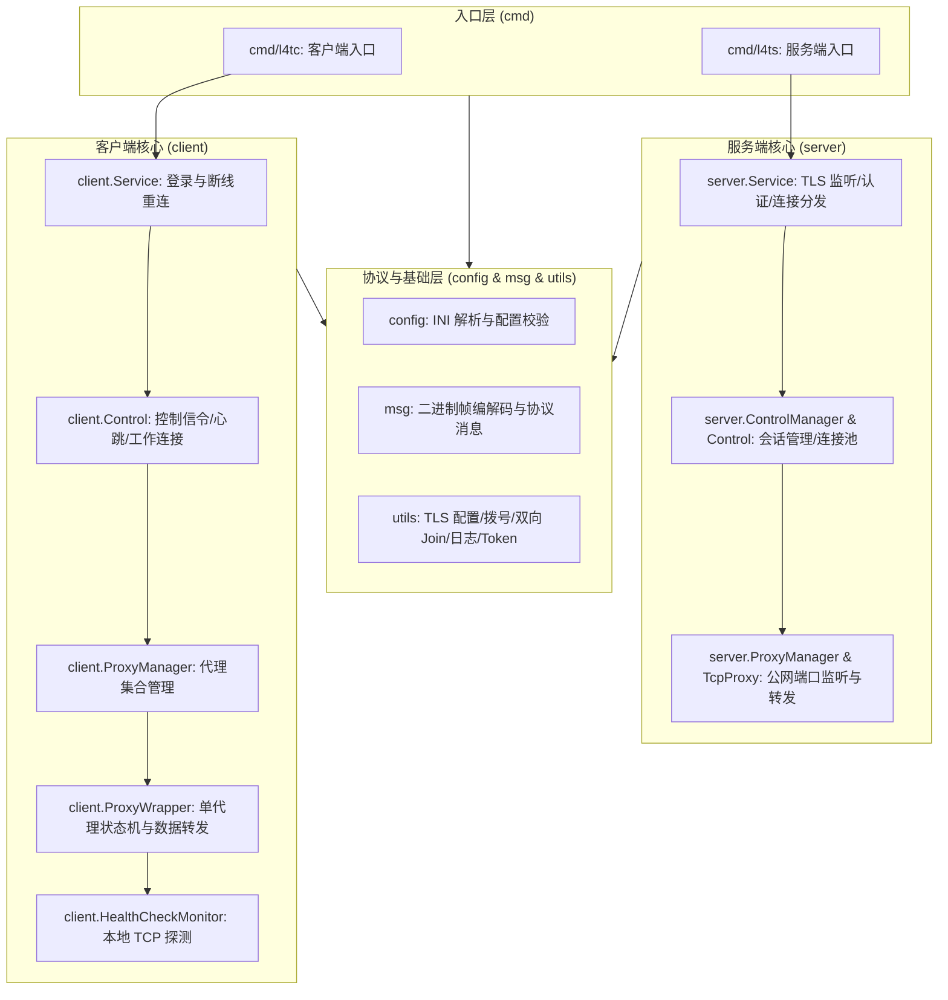
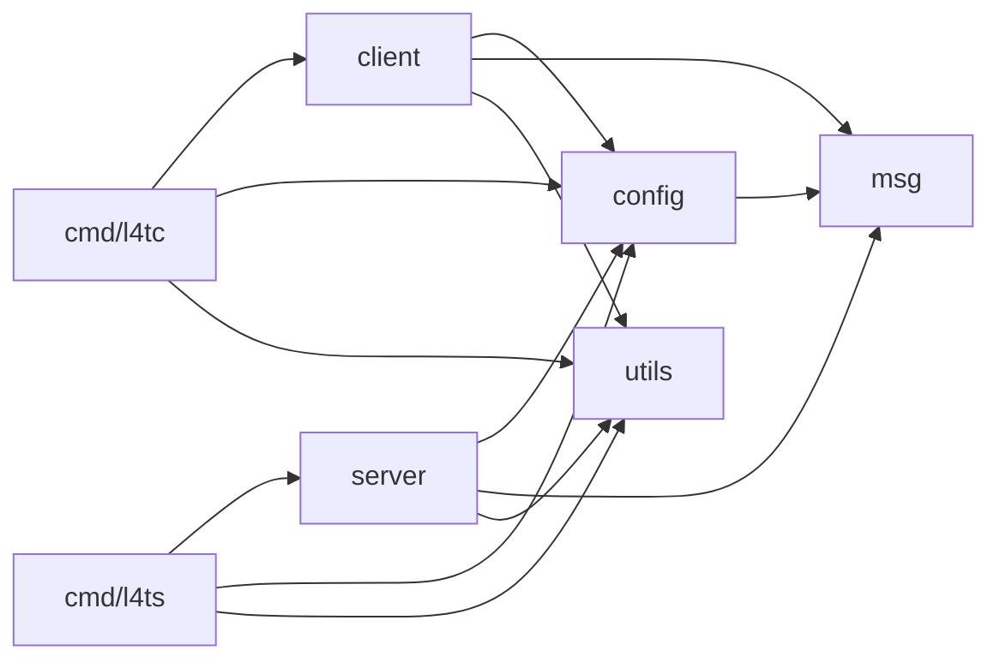
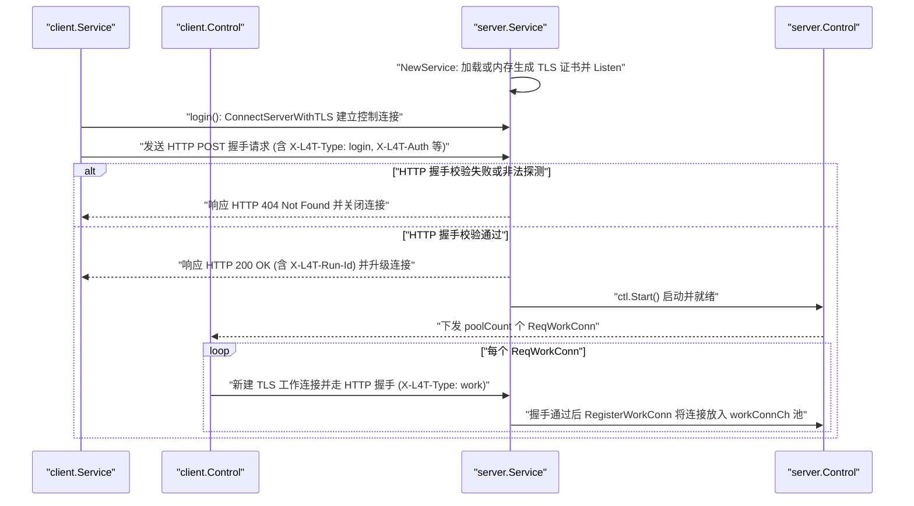

# L4Tunnel 代码结构与架构说明

L4Tunnel 是一个纯 Go 标准库实现（零第三方依赖）的四层 TCP 内网穿透工具，支持标准 TLS 加密传输、Token 认证、预建工作连接池、断线重连接管以及客户端四层 TCP 健康检查。

当前 Go 源码共 **16 个文件**，所有功能模块均为单层扁平化设计，分为 `cmd`、`client`、`server`、`config`、`msg`、`utils` 六个独立顶层模块。

---

## 一、整体分层架构



---

## 二、文件清单与职责说明

### 1. 入口层（`cmd/`）

| 文件 | 包 | 核心符号与职责 |
| :--- | :--- | :--- |
| [cmd/l4tc/main.go](cmd/l4tc/main.go) | `main` | 客户端 CLI 入口。通过标准库 `flag` 解析 `-c`（默认 `./l4tc.ini`）与 `-v`，读取并校验全局配置及代理列表，初始化日志并运行 `client.Service`。 |
| [cmd/l4ts/main.go](cmd/l4ts/main.go) | `main` | 服务端 CLI 入口。通过标准库 `flag` 解析 `-c`（默认 `./l4ts.ini`）与 `-v`，加载并校验服务端配置，初始化日志后启动 `server.Service`。 |

### 2. 客户端核心（`client/`）

| 文件 | 包 | 核心符号与职责 |
| :--- | :--- | :--- |
| [client/service.go](client/service.go) | `client` | `Service` 管理客户端生命周期：`login()` 建立 TLS 连接鉴权；`keepControllerWorking()` 监听控制通道断开并执行指数退避（1s → 20s）重连。 |
| [client/control.go](client/control.go) | `client` | `Control` 管理单次控制会话：启动 `reader`、`writer`、`msgHandler` 与 `worker`；负责心跳收发、响应服务端请求补建工作连接。 |
| [client/proxy.go](client/proxy.go) | `client` | 整合 `ProxyWrapper` 状态机与 `ProxyManager` 代理集合管理；负责健康检查联动与本地端口 `utils.Join` 数据桥接。 |
| [client/health.go](client/health.go) | `client` | `HealthCheckMonitor` 周期对本地服务执行四层 TCP `DialContext` 探测；探测结果回调驱动代理上线/下线。 |

### 3. 服务端核心（`server/`）

| 文件 | 包 | 核心符号与职责 |
| :--- | :--- | :--- |
| [server/service.go](server/service.go) | `server` | `Service` 启动 TLS 监听器（支持指定证书或内存自签）；`HandleListener` 读首帧分流 `Login`/`NewWorkConn`；`RegisterControl` 鉴权并接管旧会话。 |
| [server/control.go](server/control.go) | `server` | `ControlManager` 管理在线客户端；`Control` 维护工作连接缓冲池 `workConnCh`、处理代理注册注销与心跳检测、优雅退出时排空连接并释放端口。 |
| [server/proxy.go](server/proxy.go) | `server` | `TcpProxy` 监听公网端口；接收用户请求并从连接池取连接执行 `utils.Join` 透传；`ProxyManager` 避免代理名称冲突。 |

### 4. 配置解析（`config/`）

| 文件 | 包 | 核心符号与职责 |
| :--- | :--- | :--- |
| [config/ini.go](config/ini.go) | `config` | 纯标准库轻量 INI 解析器（`ParseIni`）与通用配置文件读取函数 `LoadConfFromFile`。 |
| [config/client_common.go](config/client_common.go) | `config` | 客户端全局配置定义 `ClientCommonConf` 与反序列化 `UnmarshalClientConfFromIni`。 |
| [config/server_common.go](config/server_common.go) | `config` | 服务端全局配置定义 `ServerCommonConf`、反序列化与证书成对校验 `Check()`。 |
| [config/proxy.go](config/proxy.go) | `config` | 四层 TCP 代理配置 `TcpProxyConf` 与 `LoadAllConfFromIni`。 |

### 5. 协议帧消息（`msg/`）

| 文件 | 包 | 核心符号与职责 |
| :--- | :--- | :--- |
| [msg/msg.go](msg/msg.go) | `msg` | 整合所有 10 种信令结构体定义与 `[1B 类型 + 4B 大端长度 + JSON 载荷]` 二进制帧编解码（`ReadMsg`、`ReadMsgInto`、`WriteMsg`），单次 5 字节固定帧头安全读取。 |

### 6. 底座工具（`utils/`）

| 文件 | 包 | 核心符号与职责 |
| :--- | :--- | :--- |
| [utils/auth.go](utils/auth.go) | `utils` | 随机 ID 生成（`RandId`）与 Token MD5 单次哈希计算（`GetAuthKey`）。 |
| [utils/log.go](utils/log.go) | `utils` | 线程安全分级轻量日志器（`InitLog`、`Logger`、`NewLogger`、`NewLogContext`、`LogFromContextSafe`），无参格式化安全优化。 |
| [utils/net.go](utils/net.go) | `utils` | 纯标准库网络连接、TLS 客户端与内存动态自签证书生成、双向数据转发管道 `Join`。 |
| [utils/version.go](utils/version.go) | `utils` | 程序版本声明（`Version()`）。 |

---

## 三、包依赖关系

代码库严格保持**单向无环依赖（DAG）**，所有包均保持单层目录：



---

## 四、核心调用逻辑与运行时序

### 1. 启动、登录鉴权与工作连接池预建



### 2. 代理注册、健康检查与数据透传

1. **代理注册**：客户端 `Control.Run()` 调用 `ProxyManager.StartAll`，为每个代理创建 `ProxyWrapper` 并启动 `checkWorker()`。若未启用 `health_check`（`health == 0`），立即发出 `NewProxy(ProxyName, RemotePort)`；服务端 `Control.RegisterProxy` 创建 `TcpProxy` 并 `net.Listen` 监听公网端口。
2. **健康检查联动**：若开启 `health_check = true`，`ProxyWrapper` 初始处于 `health = 1`（未就绪），同时启动 `HealthCheckMonitor` 定期对 `LocalIp:LocalPort` 做四层 TCP 拨号：
   - 探测成功：`failedTimes` 清零，回调 `statusNormalCallback` 将状态置为 `health = 0`，`checkWorker()` 向服务端发送 `NewProxy` 打开公网监听。
   - 连续失败达 `defaultHealthCheckMaxFail` 次：回调 `statusFailedCallback` 将 `health = 1`，`checkWorker()` 向服务端发送 `CloseProxy` 关闭公网监听端口，待本地服务恢复后再自动重新注册。
3. **用户流量转发**：
   - 外部用户连接服务端 `TcpProxy` 的公网监听端口后，`handleUserTcpConnection` 调用 `getWorkConnFromPool()` 从 `workConnCh` 取出一条预建 TLS 工作连接（同时触发服务端向客户端补发一条 `ReqWorkConn` 补仓）。
   - 服务端向该工作连接写入 `StartWorkConn(ProxyName)` 并进入 `utils.Join(workConn, userConn)`。
   - 客户端 `HandleReqWorkConn` 阻塞读取到 `StartWorkConn` 后，通过 `ProxyManager.HandleWorkConn` 路由到对应 `ProxyWrapper.InWorkConn`，拨号本地服务 `LocalIp:LocalPort` 并调用 `utils.Join(localConn, workConn)` 完成全双工四层透传。

### 3. 心跳保活、异常退出与断线重连

- **心跳保活**：客户端 `Control.msgHandler` 每隔 30 秒发送 `Ping`，服务端回复 `Pong` 并刷新心跳时间；若任意一端超过 90 秒未收到对方心跳，主动断开连接触发清理。
- **服务端资源回收**：读写出错、心跳超时或同 `runId` 客户端重连时，服务端调用 `triggerStop()`，排空并关闭预建工作连接，解绑公网监听端口并从 `ProxyManager` 注销。
- **客户端断线重连**：`Control` 退出后，`client.Service` 捕获退出事件并进入指数退避重连流程（1s 起步，上限 20s），成功后复用原有 `runId` 恢复全部代理。

---

## 五、控制面帧协议格式

所有经 TLS 隧道传输的信令消息均由 [msg/msg.go](msg/msg.go) 统一封包与解包：

```text
+------------+----------------------+--------------------------+
|  1 Byte    |       4 Bytes        |        N Bytes           |
| Type Byte  | Payload Length (BE)  |  JSON UTF-8 Payload      |
+------------+----------------------+--------------------------+
```

| Type 字节 | 常量名 | 方向 | 说明 |
| :---: | :--- | :--- | :--- |
| `'o'` | `TypeLogin` | Client → Server | 登录认证与连接池大小申报 |
| `'1'` | `TypeLoginResp` | Server → Client | 返回分配/确认的 `RunId` 或错误信息 |
| `'p'` | `TypeNewProxy` | Client → Server | 请求服务端监听指定 `RemotePort` |
| `'2'` | `TypeNewProxyResp` | Server → Client | 返回代理注册结果 |
| `'c'` | `TypeCloseProxy` | Client → Server | 请求停止代理并释放公网监听端口 |
| `'r'` | `TypeReqWorkConn` | Server → Client | 请求客户端补充预建工作连接 |
| `'w'` | `TypeNewWorkConn` | Client → Server | 新工作连接向对应 `RunId` 会话注册入池 |
| `'s'` | `TypeStartWorkConn` | Server → Client | 通知工作连接关联的 `ProxyName`，随后进入纯流透传 |
| `'h'` | `TypePing` | Client → Server | 客户端心跳探测 |
| `'4'` | `TypePong` | Server → Client | 服务端心跳响应 |
